<div align="center">

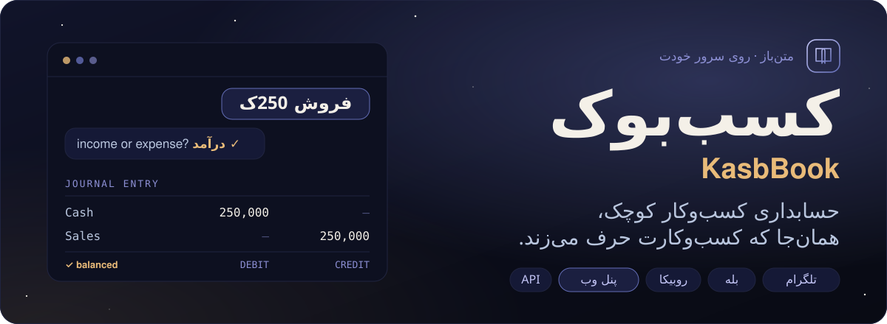

<p>
  <a href="https://kasbbook.nyxon.tech"></a>
  <a href="https://emadhabibnia1385.github.io/KasbBook/fa/"></a>
  <a href="https://kasbbook.nyxon.tech/docs"></a>
</p>

[](https://github.com/Emadhabibnia1385/KasbBook/actions)
[](https://www.python.org)
[](https://fastapi.tiangolo.com)
[](https://react.dev)
[](https://postgresql.org)
[](https://github.com/Emadhabibnia1385/KasbBook/releases)
[](./LICENSE)

🌐 [English](./README.md) · **فارسی**

[پنل وب](#-پنل-وب) · [ثبت سریع](#-ثبت-سریع) · [چه کارهایی می‌کند](#-چه-کارهایی-میکند) · [معماری](#-معماری) · [نصب](#-نصب) · [API](#-رابط-برنامهنویسی) · [توسعه](#-توسعه)

</div>

<div dir="rtl">

بنویس `فروش 250ک`، بگو درآمد است یا هزینه، و ثبت می‌شود. یک حساب واحد از **تلگرام،
بله و روبیکا**، از **پنل وب** و از **API** کار می‌کند. پول دقیق است، تقویم جلالی
است (و میلادی کنارش)، و پشت هر تراکنش یک سند دوطرفهٔ تراز نشسته است.

> **می‌خواهی اول ببینی؟** برو به **<https://kasbbook.nyxon.tech>** و **«ورود به حساب دمو»**
> را بزن. با چهار دفتر و یک سال تراکنش آماده وارد می‌شوی. این یک حساب مشترک برای
> همه است، پس چیز مهمی در آن ننویس.

---

## ◆ پنل وب

هرچه ربات می‌کند، با نمودار، جدول و فیلتر، توی مرورگر یا نصب‌شده مثل یک برنامه روی
گوشی. همان حساب و همان قاعده‌ها.

</div>

<table>
  <tr>
    <td colspan="2">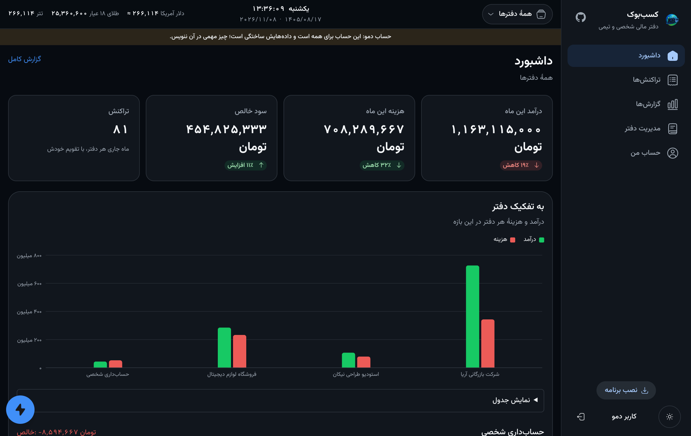</td>
  </tr>
  <tr>
    <td width="50%">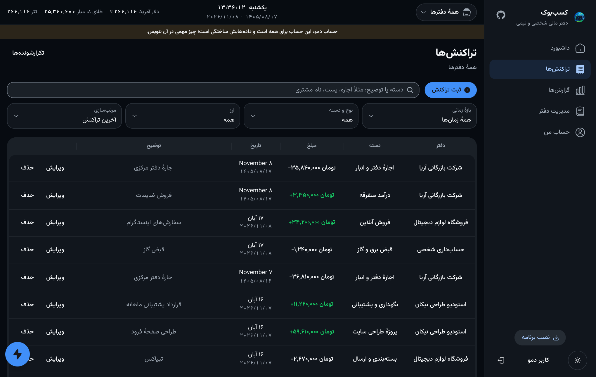</td>
    <td width="50%">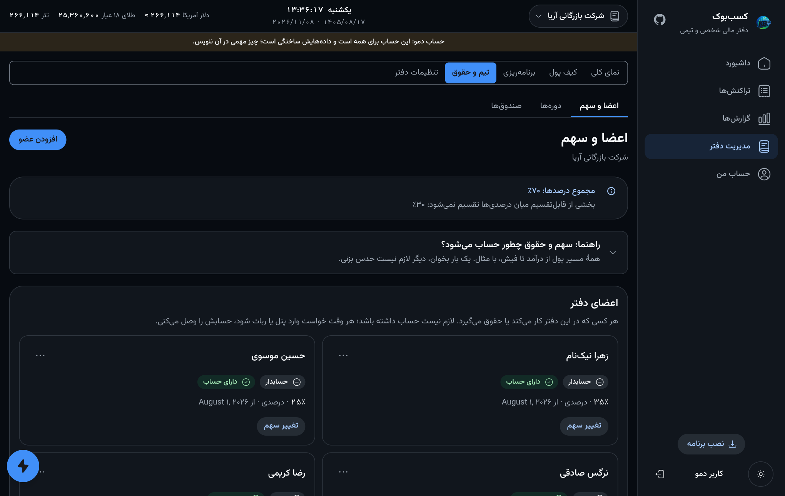</td>
  </tr>
  <tr>
    <td width="50%">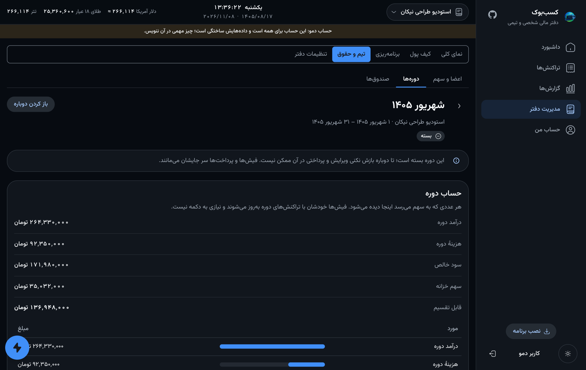</td>
    <td width="50%">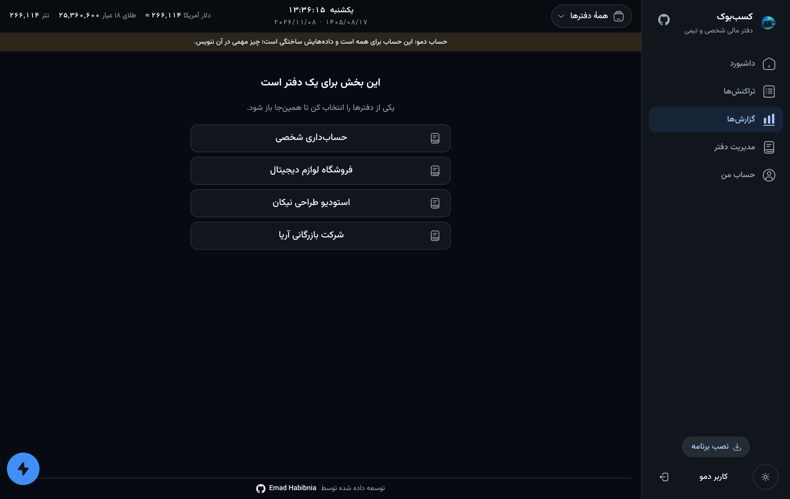</td>
  </tr>
  <tr>
    <td width="50%">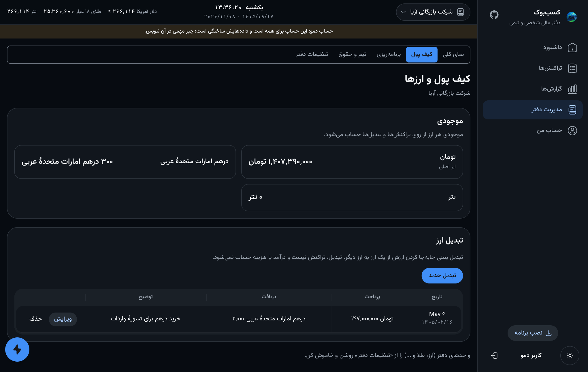</td>
    <td width="50%">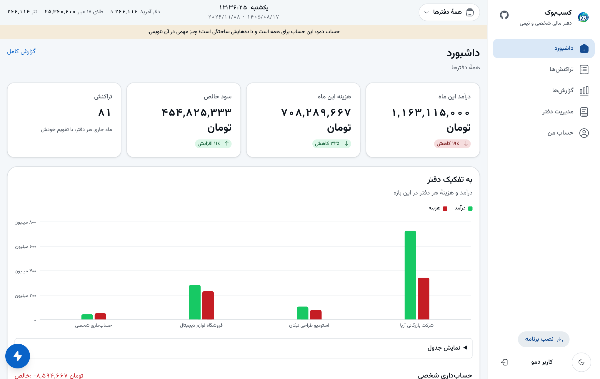</td>
  </tr>
</table>

<p align="center">
  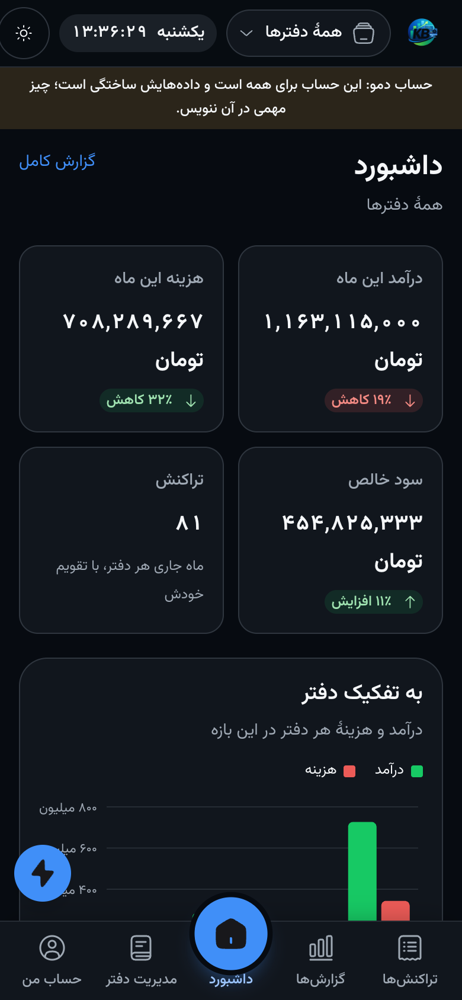
  &nbsp;
  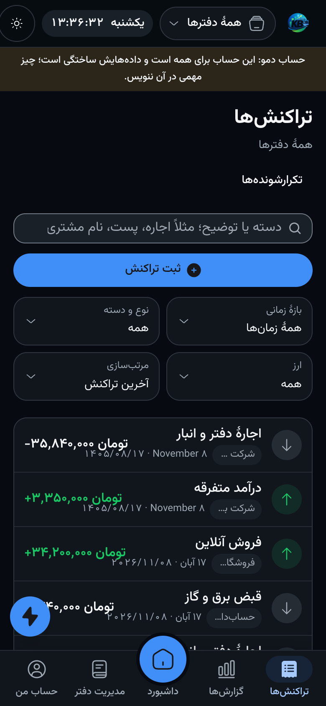
</p>

<div dir="rtl">

- **داشبورد، تراکنش‌ها، گزارش** — خلاصهٔ ماه، فهرستی که می‌شود در آن جست‌وجو و فیلتر کرد، نمودار ماهانه و بر اساس دسته.
- **دو تقویم** — هر تاریخ هم شمسی نوشته می‌شود هم میلادی، کنار هم.
- **کیف پول** — موجودی هر ارز؛ تبدیلی که مقدار دریافتی و ارزش را از قیمت لحظه‌ای پر می‌کند؛ و دکمه‌های یک‌چهارم، نصف و حداکثر موجودی.
- **تیم و حقوق** — عضو (حتی کسی که هنوز حساب ندارد)، سهم درصدی، مبلغ ثابت، روزانه، ساعتی، امتیازی یا وزن ثابت، استثنا برای یک دوره، فیش، پرداخت مرحله‌ای، صندوق‌ها، و دوره‌ای که بسته شده و دوباره باز می‌شود.
- **رویدادها** — چه کسی چه کاری کرد و کِی، از پنل، ربات یا API، با فیلتر و گزارش CSV.
- **ورود** — از راه ربات در تلگرام، یا با نام کاربری و رمز؛ فهرست دستگاه‌ها هر دستگاه را یک بار نشان می‌دهد.

## ◆ چیست

سامانهٔ دفترداری برای مغازه‌دار، فریلنسر و تیم کوچک، که خودت روی سرور خودت
اجرا می‌کنی. نه چیزی روی گوشی نصب می‌شود و نه چیزی باید حفظ شود: یک خط متن یا
چند دکمه، داخل همان پیام‌رسانی که باز است — یا پنل، وقتی تصویر کامل را می‌خواهی.

پایه‌اش API است. ربات و پنل مشتری‌های همان سرویس‌هایی هستند که API بیرون
می‌دهد — و به همین دلیل نمی‌شود قاعده‌ای را یک‌جا رعایت کرد و جای دیگر یادش رفت.

> **این نسخه بتاست.** برای نویسنده‌اش در تولید اجرا می‌شود و تست‌هایش کامل‌اند،
> ولی هنوز دست آدم‌های زیاد و دفترهای زیاد نبوده. پشتیبان بگیر —
> `scripts/backup.sh` این کار را برایت می‌کند — و
> [docs/roadmap.fa.md](./docs/roadmap.fa.md) را بخوان تا بدانی چه چیزی عمداً ساخته نشده.

## ◆ ثبت سریع

یک خط متن و یک لمس، به‌جای گشتن در منو.

```
فروش 250ک              →  «فروش»، 250,000، امروز
اجاره 1.2م بابت مرداد  →  «اجاره»، 1,200,000، با توضیح «بابت مرداد»
دیروز خرید 125000      →  «خرید»، 125,000، با تاریخ دیروز
```

اول دسته می‌آید و مبلغ خط را دو تکه می‌کند: هر چه بعد از مبلغ بیاید توضیح است؛
تاریخ هم می‌تواند اول خط بنشیند. ارقام فارسی یا لاتین، `ک` برای هزار و `م` برای
میلیون — چسبیده به عدد یا جدا از آن — و تاریخ جلالی با هر جداکننده‌ای. بعد یک لمس
می‌گوید درآمد است یا هزینه، چون تنها چیزی که از دسته درنمی‌آید همین جهت است.

هر چیزی که دوپهلو باشد پرسیده می‌شود، حدس زده نمی‌شود — و خرابی‌ای که باید از آن
ترسید همان بی‌صداست: جایی که یک ضریب هزارگانِ افتاده، 250,000 را 250 ثبت می‌کند.
برای هر شکلی که این خط می‌تواند داشته باشد تستی هست که معنایش را میخ می‌کند.
چیدمان صفحه‌های پشت این خط در
[docs/conversation-design.md](./docs/conversation-design.fa.md) است.

## ◆ چه کارهایی می‌کند

| | |
|---|---|
| **دفترها** | شخصی، کسب‌وکار، تیمی، سازمانی — یک حساب، چند دفتر |
| **دفتر کل** | پشت هر تراکنش یک سند دوطرفهٔ تراز |
| **چندارزی** | نرخ در همان لحظهٔ تراکنش ثبت می‌شود و بعداً دوباره اعمال نمی‌شود |
| **گزارش** | ماهانه، سالانه، هفتگی یا بر اساس دسته، جلالی؛ خروجی CSV |
| **بودجه** | سقف برای هر دسته یا هر جهت، با باقی‌مانده |
| **طلب و بدهی** | چه کسی به چه کسی بدهکار است؛ تسویه تراکنش واقعی می‌سازد |
| **وام** | اقساط، پرداخت‌شده‌ها، قسط بعدی |
| **تکرارشونده** | اجاره و حقوق یک بار تعریف می‌شوند و سر موعد ثبت می‌شوند |
| **حقوق و سهم** | دوره، سهم اعضا، کسر و اضافه، فیش، پرداخت مرحله‌ای |
| **خزانه** | صندوق‌هایی که با قاعده تغذیه می‌شوند، پیش از تقسیم سود |
| **یادآور** | خلاصهٔ روزانه در ساعتی که خودت انتخاب می‌کنی، به وقت خودت |
| **رسید** | عکس یا PDF، با ارجاع روی خودِ پیام‌رسان ذخیره می‌شود نه با آپلود دوباره |
| **جست‌وجو** | در دسته و توضیح، با مجموع همهٔ نتیجه‌ها |
| **حساب کاربری** | ایمیل، شماره، رمز، نشست‌ها — و حذفی که دفتر کل را قابل‌اثبات نگه می‌دارد |
| **اشتراک** | دعوت همکار با ایمیل یا شماره، با نقش و دسترسی جداگانه برای هر کار |
| **پنل وب** | داشبورد، فهرست‌ها، نمودار، کیف پول، تیم و حقوق؛ روی گوشی هم نصب می‌شود |
| **رویدادها** | چه کسی چه کاری کرد و کِی، از هر مشتری، با فیلتر و CSV |
| **API** | همان سرویس‌هایی که ربات صدا می‌زند، با توکن چرخشی و کلید API |

## ◆ معماری

</div>

<p align="center">
  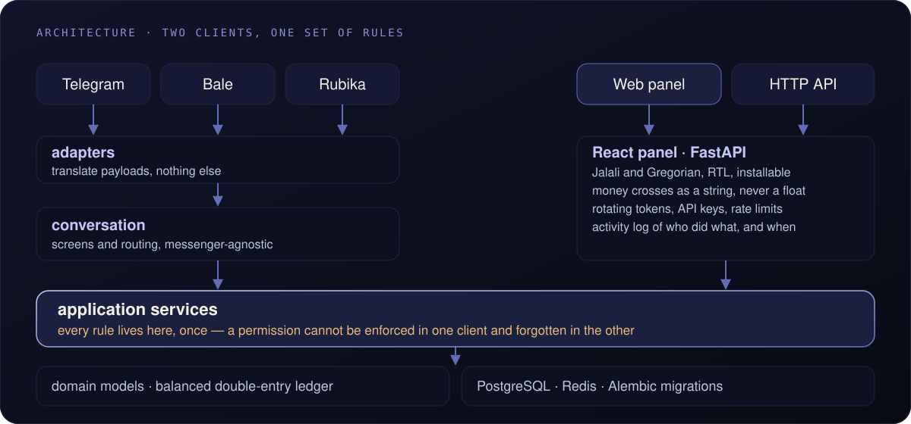
</p>

<div dir="rtl">

دو نوع مشتری، یک مجموعه قاعده. هیچ آداپتوری به دیتابیس دست نمی‌زند — تستی گراف
import را می‌پیماید و اگر یکی‌شان بخواهد، بیلد را قرمز می‌کند. توضیح در
[docs/architecture.fa.md](./docs/architecture.fa.md).

## ◆ نصب

روی یک سرور تازهٔ دبیان یا اوبونتو، یک دستور:

```bash
curl -fsSL https://raw.githubusercontent.com/Emadhabibnia1385/KasbBook/main/scripts/install.sh | sudo bash
```

نسخهٔ پایتون را بررسی می‌کند، کد را می‌آورد، پستگرس و ردیس را در کانتینر بالا
می‌آورد، هر رمزی را که بشود خودش می‌سازد، فقط توکن ربات را می‌پرسد، اسکیما را
می‌سازد، هر دو سرویس را نصب می‌کند و بعد بررسی می‌کند که واقعاً بالا آمده‌اند.
دو بار اجرا کردنش هم بی‌خطر است.

| | |
|---|---|
| به‌روزرسانی | `sudo /opt/kasbbook/scripts/update.sh` |
| پشتیبان | `sudo /opt/kasbbook/scripts/backup.sh` |
| بازگردانی | `sudo /opt/kasbbook/scripts/restore.sh <file>` |
| حذف | `sudo /opt/kasbbook/scripts/uninstall.sh` |

اسکریپت به‌روزرسانی اول پشتیبان می‌گیرد، تست می‌گیرد، مایگریت می‌کند، ری‌استارت
می‌کند و اگر نسخهٔ تازه تمیز بالا نیامد **خودش برمی‌گرداند**. توضیح کامل در
[docs/operations.md](./docs/operations.fa.md).

## ◆ رابط برنامه‌نویسی

```bash
curl -X POST http://127.0.0.1:8210/api/v1/auth/login \
  -H 'Content-Type: application/json' \
  -d '{"identifier":"you@example.com","password":"..."}'
```

مستندات تعاملی روی `/docs` — استقرار مرجع روی
<https://kasbbook.nyxon.tech/docs> است. توکن دسترسی کوتاه‌عمر، توکن تازه‌سازیِ
چرخشی با تشخیص سرقت، کلید API برای برنامه‌ها، و محدودیت نرخ روی مسیرهایی که
لازم دارند.

**پول به‌صورت رشته از این مرز رد می‌شود، نه عدد JSON.** JSON یک نوع عددی دارد و
آن هم float است؛ `12500000.15` سالم از این رفت‌وبرگشت بیرون نمی‌آید، و APIای
که ریال گم می‌کند API حساب‌داری نیست.

توضیح در [docs/api.md](./docs/api.fa.md).

## ◆ توسعه

```bash
git clone https://github.com/Emadhabibnia1385/KasbBook.git
cd KasbBook && python3 -m venv venv
./venv/bin/pip install -r requirements-dev.txt
./venv/bin/python -m pytest tests -q
```

کل تست‌ها روی SQLite اجرا می‌شوند، بدون شبکه و بدون توکن: یک کلون و نصب
وابستگی‌های توسعه، تمام چیزی است که لازم دارند. تست‌های مایگریشن اگر
`KASBBOOK_TEST_POSTGRES_URL` تنظیم باشد روی پستگرس واقعی هم تمرین می‌کنند، و CI
دقیقاً همین کار را می‌کند، چون خرابی‌های جالب همان‌جا زندگی می‌کنند.

توضیح در [docs/development.md](./docs/development.fa.md).

## ◆ مستندات

| | |
|---|---|
| [شروع](./docs/getting-started.fa.md) | نصب، اجرای اول، اولین دفتر |
| [معماری](./docs/architecture.fa.md) | لایه‌ها و دلیل جای‌گیری‌شان |
| [پیکربندی](./docs/configuration.fa.md) | همهٔ متغیرهای محیطی |
| [مدل داده](./docs/data-model.fa.md) | حساب، هویت، دفتر، دسترسی |
| [دوطرفه](./docs/double-entry.fa.md) | دفتر کل چطور تراز می‌ماند |
| [حقوق و خزانه](./docs/payroll.fa.md) | دوره، سهم، صندوق، فیش |
| [طراحی گفت‌وگو](./docs/conversation-design.fa.md) | واژگان ربات، صفحه‌کلیدها، و هزینهٔ هر لمس |
| [پیام‌رسان‌ها](./docs/providers.fa.md) | تلگرام، بله، روبیکا، و افزودن یکی تازه |
| [API](./docs/api.fa.md) | مسیرها، احراز هویت، قراردادها |
| [امنیت](./docs/security.fa.md) | توکن، هش، چه چیزی ذخیره می‌شود و چه چیزی نه |
| [عملیات](./docs/operations.fa.md) | استقرار، پشتیبان، بازگردانی، عقب‌گرد |
| [توسعه](./docs/development.fa.md) | تست، مایگریشن، قراردادها |
| [عیب‌یابی](./docs/troubleshooting.fa.md) | خرابی‌های واقعی و علت‌شان |
| [نقشهٔ راه](./docs/roadmap.fa.md) | چه چیزی عمداً هنوز ساخته نشده |

همین صفحه‌ها به‌شکل یک سایت هم منتشر شده‌اند — قابل جست‌وجو، به فارسی و انگلیسی:

| | |
|---|---|
| 🇮🇷 فارسی | <https://emadhabibnia1385.github.io/KasbBook/fa/> |
| 🇬🇧 English | <https://emadhabibnia1385.github.io/KasbBook/> |

## ◆ پروانه

MIT — [LICENSE](./LICENSE).

</div>

<br>

<p align="center">
  <a href="https://github.com/Emadhabibnia1385"></a>
</p>
