<div align="center">

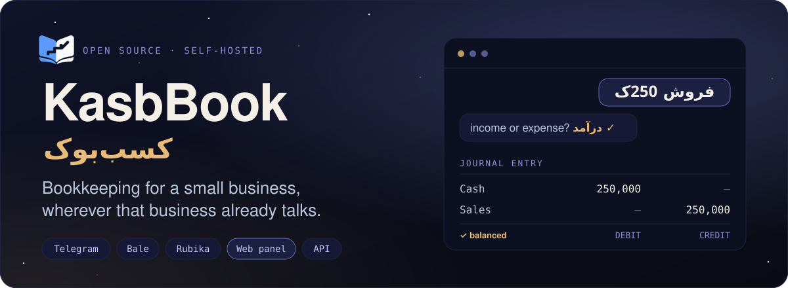

<p>
  <a href="https://kasbbook.nyxon.tech"></a>
  <a href="https://emadhabibnia1385.github.io/KasbBook/"></a>
  <a href="https://kasbbook.nyxon.tech/docs"></a>
</p>

[](https://github.com/Emadhabibnia1385/KasbBook/actions)
[](https://www.python.org)
[](https://fastapi.tiangolo.com)
[](https://react.dev)
[](https://postgresql.org)
[](https://github.com/Emadhabibnia1385/KasbBook/releases)
[](./LICENSE)

🌐 **English** · [فارسی](./README.fa.md)

[The panel](#-the-web-panel) · [Quick entry](#-quick-entry) · [What it does](#-what-it-does) · [Architecture](#-architecture) · [Install](#-install) · [API](#-the-api) · [Development](#-development)

</div>

Type `فروش 250ک`, say whether it is income or expense, and it is recorded. The
same account works from **Telegram, Bale and Rubika**, in a **web panel**, and
over an **HTTP API**. Money is exact, the calendar is Jalali (Gregorian beside
it), and every transaction has a balanced journal entry behind it.

> **Want to look around first?** Open **<https://kasbbook.nyxon.tech>** and press
> **«ورود به حساب دمو»**. It signs you in to a ready-made demo with four books and a
> year of transactions. It is one shared account for everybody, so put nothing
> that matters in it. The panel is in Persian (right to left).

---

## ◆ The web panel

Everything the bot does, with charts, tables and filters, in the browser or installed
as an app on a phone. The same account, the same rules.

<table>
  <tr>
    <td colspan="2">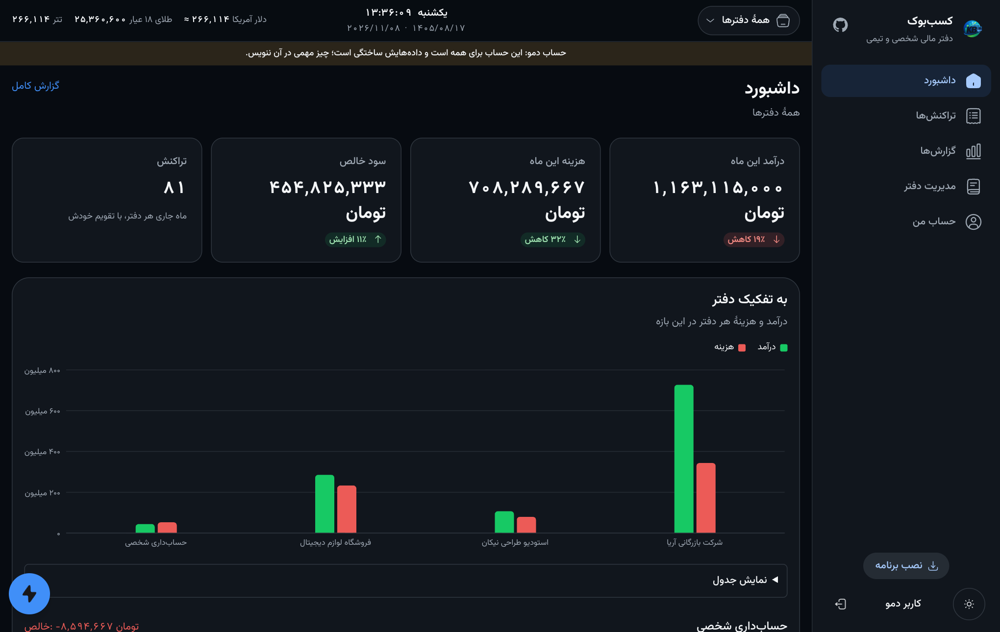</td>
  </tr>
  <tr>
    <td width="50%">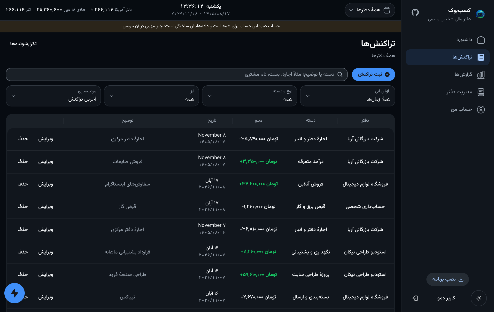</td>
    <td width="50%">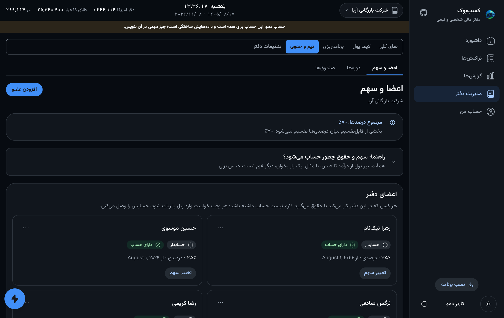</td>
  </tr>
  <tr>
    <td width="50%">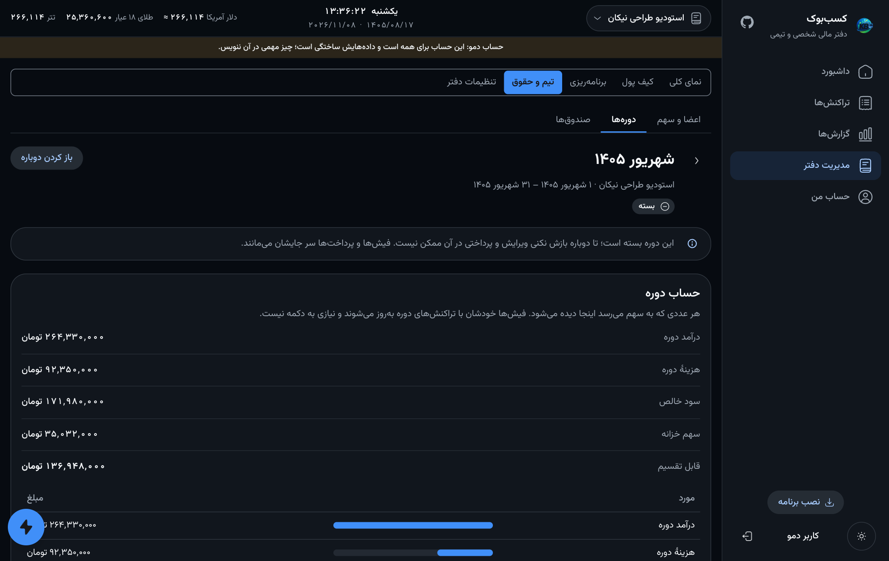</td>
    <td width="50%">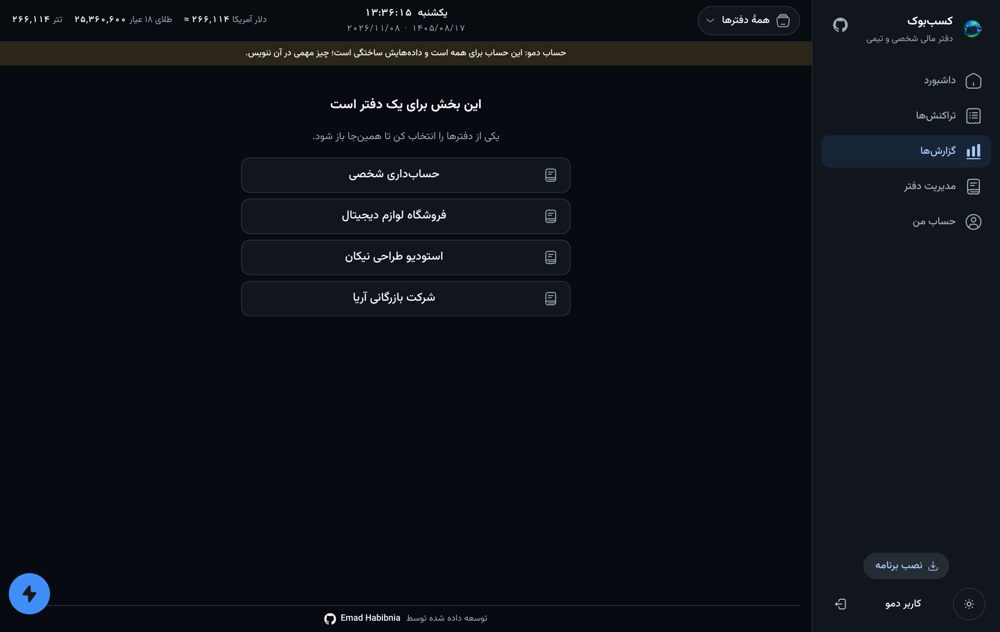</td>
  </tr>
  <tr>
    <td width="50%">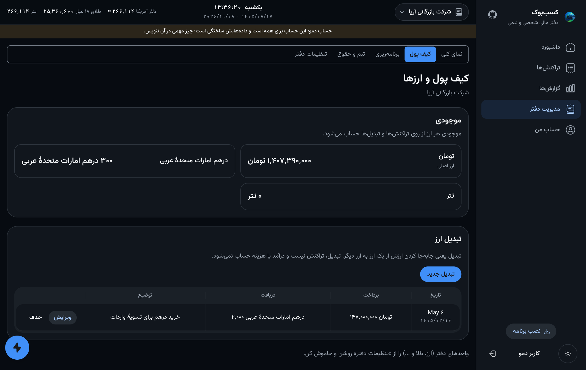</td>
    <td width="50%">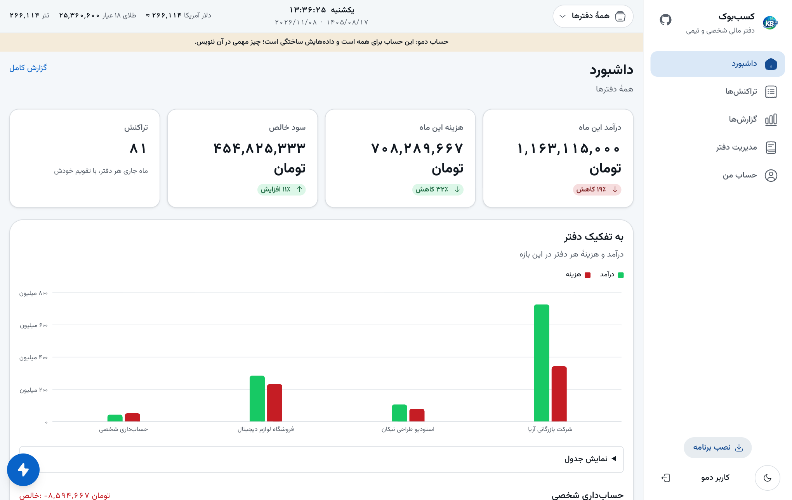</td>
  </tr>
</table>

<p align="center">
  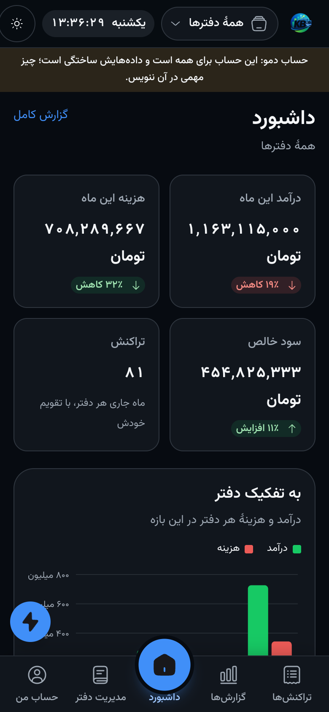
  &nbsp;
  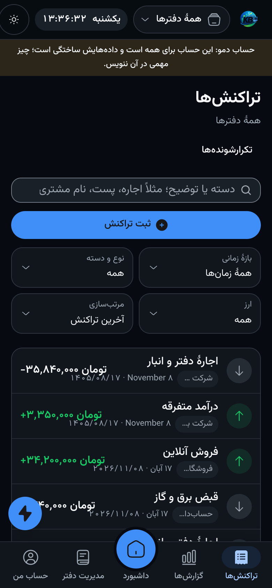
</p>

- **Dashboard, transactions, reports** — a month at a glance, a list you can search and filter, charts by month and by category.
- **Both calendars** — every date is written in Jalali and Gregorian side by side.
- **Wallet** — a balance per currency, conversions that fill the received amount and the worth from today's price, and buttons for a quarter, half or all of a balance.
- **Team and payroll** — members (even people with no account yet), shares by percent, fixed amount, days, hours, points or fixed weight, one-period exceptions, payslips, staged payment, funds, and a closed period that can be opened again.
- **Activity log** — who did what and when, from the panel, the bot or the API, with filters and a CSV report.
- **Sign-in** — through the bot on Telegram, or with a username and password; a device list that shows each device once.

## ◆ What it is

A self-hosted bookkeeping system for shopkeepers, freelancers and small teams.
Nothing to install on a phone, nothing to memorise: one line of text or a few
buttons, in the messenger people already have open — or a panel when they want
the whole picture.

It is API-first. The bot and the panel are clients of the same services the HTTP
API exposes, which is why a permission cannot be enforced in one place and
forgotten in the other.

> **This is a beta.** It runs in production for its author and its tests are
> thorough, but it has not been run by many people on many books yet. Take
> backups — `scripts/backup.sh` does it for you — and read
> [docs/roadmap.md](./docs/roadmap.md) for what is deliberately not built.

## ◆ Quick entry

A typed line and one tap, instead of a walk through menus.

```
فروش 250ک              →  "فروش", 250,000, today
اجاره 1.2م بابت مرداد  →  "اجاره", 1,200,000, note "بابت مرداد"
دیروز خرید 125000      →  "خرید", 125,000, dated yesterday
```

The category leads and the amount splits the line, so whatever follows it is
the note; a date may sit before the category. Digits in either script, `ک` for
thousand and `م` for million whether glued to the number or standing beside it,
Jalali dates with any separator. One tap then says income or expense, because
the one thing a category cannot settle is the direction.

Anything ambiguous is asked about rather than guessed — and the failure worth
guarding against is the silent kind, where a dropped thousand-fold multiplier
books 250,000 as 250. Every form the line may take has a test pinning what it
means. The screens behind it are laid out in
[docs/conversation-design.md](./docs/conversation-design.md).

## ◆ What it does

| | |
|---|---|
| **Books** | personal, business, team, organization — one account, many books |
| **Ledger** | every transaction mirrored by a balanced double-entry journal |
| **Multi-currency** | rate captured at the moment of the transaction, never re-applied later |
| **Reports** | by month, year, week or category, in Jalali; CSV export |
| **Budgets** | a ceiling per category or per direction, with what is left |
| **Debts** | who owes whom, settled into a real transaction |
| **Loans** | instalments, what is paid, what is next |
| **Recurring** | rent and salary defined once, booked when due |
| **Payroll** | periods, member shares, bonuses and deductions, payslips, staged payment |
| **Treasury** | funds fed by rules, taken before profit is shared |
| **Reminders** | a daily digest at an hour you choose, in your own timezone |
| **Receipts** | a photo or a PDF, stored by reference on the messenger, never re-uploaded |
| **Search** | across categories and descriptions, with the total of every match |
| **Accounts** | email, phone, password, sessions — and deletion that keeps the ledger provable |
| **Sharing** | invite colleagues by email or phone, with roles and per-action permissions |
| **Web panel** | dashboard, lists, charts, wallet, team and payroll, installable on a phone |
| **Activity log** | who did what and when, from any client, with filters and CSV |
| **API** | the same services the bot uses, with rotating tokens and API keys |

## ◆ Architecture

<p align="center">
  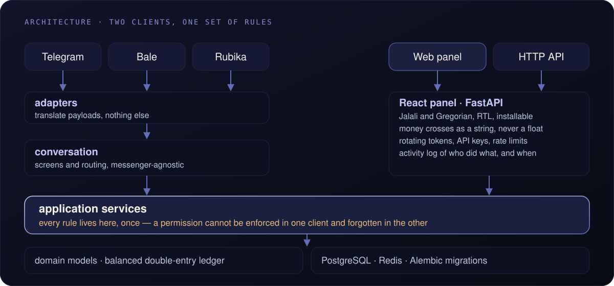
</p>

Two kinds of client, one set of rules. An adapter never touches the database — a
test walks the import graph and fails the build if one tries. See
[docs/architecture.md](./docs/architecture.md).

## ◆ Install

One command on a fresh Debian or Ubuntu box:

```bash
curl -fsSL https://raw.githubusercontent.com/Emadhabibnia1385/KasbBook/main/scripts/install.sh | sudo bash
```

It checks the Python version, clones the code, starts PostgreSQL and Redis in
containers, generates the credentials it can generate, asks only for a bot
token, creates the schema, installs both services and then checks they actually
came up. Running it twice is safe.

| | |
|---|---|
| Update | `sudo /opt/kasbbook/scripts/update.sh` |
| Back up | `sudo /opt/kasbbook/scripts/backup.sh` |
| Restore | `sudo /opt/kasbbook/scripts/restore.sh <file>` |
| Remove | `sudo /opt/kasbbook/scripts/uninstall.sh` |

The update script takes a backup, runs the tests, migrates, restarts, and
**rolls itself back** if the new version does not come up clean. See
[docs/operations.md](./docs/operations.md).

## Quick entry

A typed line and one tap, instead of a walk through menus.

```
فروش 250ک              →  "فروش", 250,000, today
اجاره 1.2م بابت مرداد  →  "اجاره", 1,200,000, note "بابت مرداد"
دیروز خرید 125000      →  "خرید", 125,000, dated yesterday
```

The category leads and the amount splits the line, so whatever follows it is
the note; a date may sit before the category. Digits in either script, `ک` for
thousand and `م` for million whether glued to the number or standing beside it,
Jalali dates with any separator. One tap then says income or expense, because
the one thing a category cannot settle is the direction.

Anything ambiguous is asked about rather than guessed — and the failure worth
guarding against is the silent kind, where a dropped thousand-fold multiplier
books 250,000 as 250. Every form the line may take has a test pinning what it
means. The screens behind it are laid out in
[docs/conversation-design.md](./docs/conversation-design.md).

## What it does

| | |
|---|---|
| **Books** | personal, business, team, organization — one account, many books |
| **Ledger** | every transaction mirrored by a balanced double-entry journal |
| **Multi-currency** | rate captured at the moment of the transaction, never re-applied later |
| **Reports** | by month, year, week or category, in Jalali; CSV export |
| **Budgets** | a ceiling per category or per direction, with what is left |
| **Debts** | who owes whom, settled into a real transaction |
| **Loans** | instalments, what is paid, what is next |
| **Recurring** | rent and salary defined once, booked when due |
| **Payroll** | periods, member shares, bonuses and deductions, payslips, staged payment |
| **Treasury** | funds fed by rules, taken before profit is shared |
| **Reminders** | a daily digest at an hour you choose, in your own timezone |
| **Receipts** | a photo or a PDF, stored by reference on the messenger, never re-uploaded |
| **Search** | across categories and descriptions, with the total of every match |
| **Accounts** | email, phone, password, sessions — and deletion that keeps the ledger provable |
| **Sharing** | invite colleagues by email or phone, with roles and per-action permissions |
| **API** | the same services the bot uses, with rotating tokens and API keys |

## Architecture

```
                  Telegram      Bale      Rubika
                      │           │          │
                      └─────── adapters ─────┘      translate payloads, nothing else
                                  │
                    ┌─────────────┴─────────────┐
                    │      conversation         │   screens + routing, messenger-agnostic
                    └─────────────┬─────────────┘
                                  │
   HTTP API  ──────────────►  application services  ◄── every rule lives here, once
                                  │
                          domain models · ledger
                                  │
                        PostgreSQL · Redis · Alembic
```

Two clients, one set of rules. An adapter never touches the database — a test
walks the import graph and fails the build if one tries. See
[docs/architecture.md](./docs/architecture.md).

## ◆ The API

```bash
curl -X POST http://127.0.0.1:8210/api/v1/auth/login \
  -H 'Content-Type: application/json' \
  -d '{"identifier":"you@example.com","password":"..."}'
```

Interactive documentation at `/docs` — the reference deployment is at
<https://kasbbook.nyxon.tech/docs>. Short-lived access tokens, rotating refresh tokens with theft
detection, API keys for programs, and rate limiting on the routes that need it.

**Money crosses the boundary as a string, never a JSON number.** JSON has one
numeric type and it is a float; `12500000.15` does not survive that round trip,
and a bookkeeping API that loses rials is not a bookkeeping API.

See [docs/api.md](./docs/api.md).

## ◆ Development

```bash
git clone https://github.com/Emadhabibnia1385/KasbBook.git
cd KasbBook && python3 -m venv venv
./venv/bin/pip install -r requirements-dev.txt
./venv/bin/python -m pytest tests -q
```

The suite runs on SQLite with no network and no token: a checkout and the dev
requirements are the whole setup. The migration tests additionally rehearse
against a real PostgreSQL when `KASBBOOK_TEST_POSTGRES_URL` is set, which is
what CI does, because that is where the interesting failures live.

See [docs/development.md](./docs/development.md).

## ◆ Documentation

| | |
|---|---|
| [Getting started](./docs/getting-started.md) | install, first run, first book |
| [Architecture](./docs/architecture.md) | the layers and why they are where they are |
| [Configuration](./docs/configuration.md) | every environment variable |
| [Data model](./docs/data-model.md) | accounts, identities, books, permissions |
| [Double-entry](./docs/double-entry.md) | how the ledger stays balanced |
| [Payroll & treasury](./docs/payroll.md) | periods, shares, funds, payslips |
| [Conversation design](./docs/conversation-design.md) | the bot's vocabulary, its keyboards, what a tap costs |
| [Providers](./docs/providers.md) | Telegram, Bale, Rubika, and adding one |
| [The API](./docs/api.md) | endpoints, auth, conventions |
| [Security](./docs/security.md) | tokens, hashing, what is stored and what is not |
| [Operations](./docs/operations.md) | deploy, back up, restore, roll back |
| [Development](./docs/development.md) | tests, migrations, conventions |
| [Troubleshooting](./docs/troubleshooting.md) | real failures and what caused them |
| [Roadmap](./docs/roadmap.md) | what is deliberately not built yet |

The same pages are published as a site — searchable, and in Persian as well:

| | |
|---|---|
| 🇬🇧 English | <https://emadhabibnia1385.github.io/KasbBook/> |
| 🇮🇷 فارسی | <https://emadhabibnia1385.github.io/KasbBook/fa/> |

## ◆ License

MIT. See [LICENSE](./LICENSE).

<br>

<p align="center">
  <a href="https://github.com/Emadhabibnia1385"></a>
</p>
