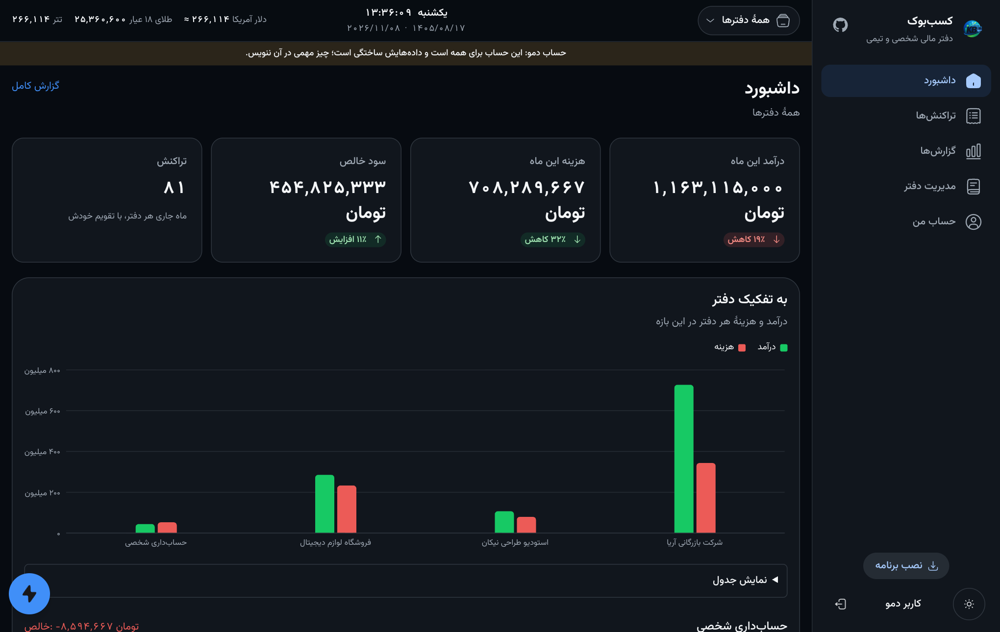
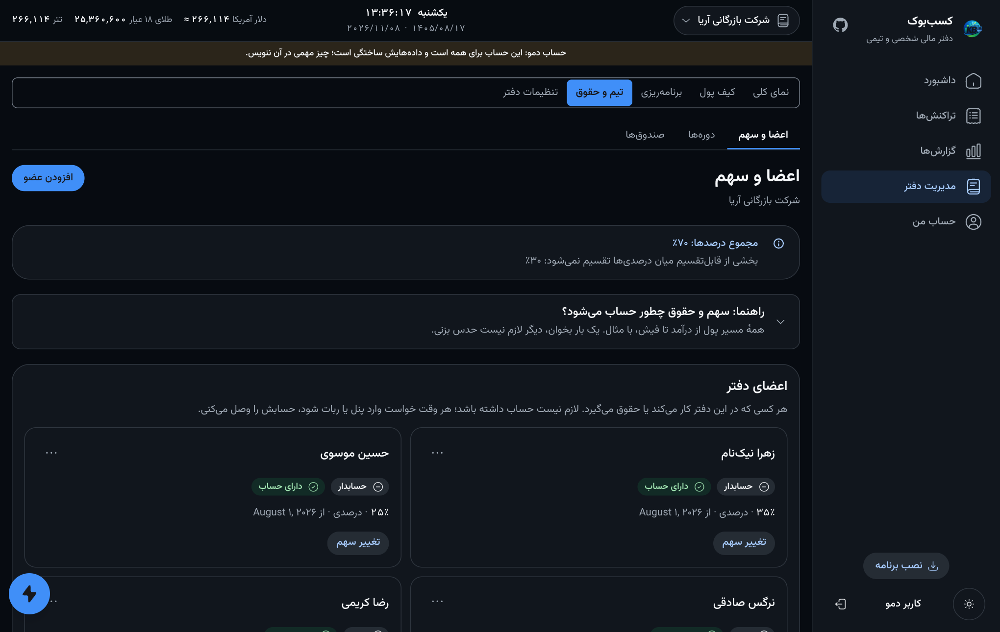
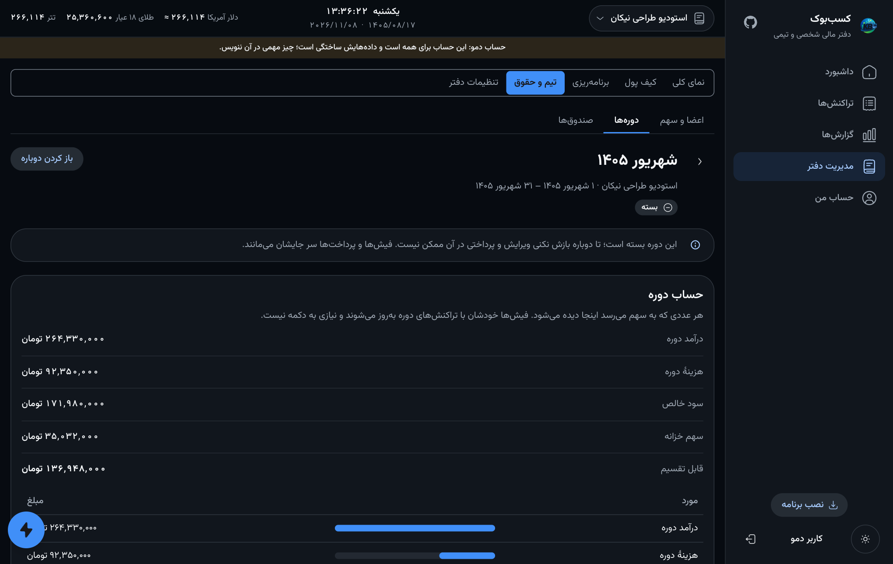

# پنل وب

پنل چهرهٔ دیگر ربات است: همان حساب، همان دفترها، همان قاعده‌ها، این‌بار برای
مرورگر. برای کارهایی است که چت در آن‌ها ضعیف است — فهرست بلند تراکنش، نمودار،
حقوق یک تیم روی یک صفحه.

**نسخهٔ زنده:** <https://kasbbook.nyxon.tech> · «ورود به حساب دمو» را بزن تا با داده‌های
آماده بگردی. دمو یک حساب مشترک برای همه است، پس چیز مهمی در آن ننویس.

## ورود

| راه | چیست |
|---|---|
| **از راه ربات** | پنل پیوندی به ربات در تلگرام نشان می‌دهد؛ یک لمس روی «تأیید ورود» این مرورگر را وارد می‌کند. هیچ رمزی تایپ نمی‌شود. |
| **نام کاربری و رمز** | در «حساب من» ساخته می‌شود؛ نام کاربری با حروف کوچک است و یکتا. |
| **دمو** | یک حساب مشترک با چهار دفتر و یک سال تراکنش. کسی نمی‌تواند صاحبش شود؛ بعد از ۱۴ روز نو می‌شود. |
| **مهمان** | حساب موقت؛ با خروج، خودش و هرچه در آن است پاک می‌شود. |

توکن تازه‌سازی کش می‌آید، پس دستگاهی که مرتب استفاده می‌شود دیگر چیزی نمی‌خواهد.
«حساب من ← دستگاه‌ها» می‌گوید حساب کجاها وارد است — **هر دستگاه یک بار**، با زمان
آخرین فعالیتش. خروج از یک دستگاه همهٔ ورودهای آن را می‌بندد.

## چه چیزهایی دارد

- **داشبورد** — درآمد، هزینه و سود خالص این ماه در برابر ماه قبل، و نمودار هر دفتر.
- **تراکنش‌ها** — جست‌وجو، فیلتر (بازه، نوع، دسته، ارز، ترتیب) که با یک انتخاب یا با «تأیید» بسته می‌شود، پیوست، و **هر تاریخ هم شمسی هم میلادی، کنار هم**.
- **گزارش‌ها** — ماهانه، سالانه یا بر اساس دسته، با خروجی CSV.
- **کیف پول** — موجودی هر ارز. تبدیل نشان می‌دهد چه مقدار قابل جابه‌جایی است، با یک‌چهارم، نصف، سه‌چهارم یا حداکثر مقدار را پر می‌کند، و مقدار دریافتی و ارزشش به ارز دفتر را از قیمت لحظه‌ای پر می‌کند (با دست هم عوض می‌شود).
- **برنامه‌ریزی** — بودجه، بدهی و وام.
- **تیم** — پایین‌تر.
- **رویدادها** («حساب من ← رویدادها») — چه کسی چه کاری کرد و کِی، از پنل، ربات یا API، با فیلتر و گزارش CSV.

## صفحه‌های تیم

**اعضا و سهم** یک صفحه است. عضو را می‌شود **فقط با نام** اضافه کرد، بدون حساب —
مثل بقیه حقوق می‌گیرد و حساب می‌شود — و بعداً با ایمیل، شماره، آیدی تلگرام یا
`@یوزرنیم` به حساب واقعی وصل کرد که سهم، فیش و کارکردش را به آن حساب می‌برد. سهم
می‌تواند درصد، مبلغ ثابت، روزانه، ساعتی، امتیازی یا وزن ثابت (*پروژه‌ای*) باشد؛ و
سهم متفاوت برای **فقط یک دوره** بعدش خودکار به سهم قبلی برمی‌گردد. راهنمایی روی
همین صفحه پول را از درآمد تا فیش با مثال می‌برد.

**دوره‌ها** تازه‌ترین بالاست. صفحهٔ دوره حساب را از درآمد تا قابل‌تقسیم نشان می‌دهد،
به‌همراه کارکرد ثبت‌شده، کسر و اضافه (با نوع، حالت، و کمک‌حسابی که روز را در مبلغ
یک روز ضرب می‌کند) و فیش‌ها با پرداخت‌هایشان. فیش‌ها خودشان با دوره به‌روز می‌شوند؛
دکمهٔ محاسبه‌ای نیست. دورهٔ بسته را کسی که می‌تواند ببندد می‌تواند **دوباره باز**
کند و چیزی از آنچه دارد از بین نمی‌رود.

**صندوق‌ها** همان خزانه است: قاعده‌هایی که پیش از تقسیم سود سهمی کنار می‌گذارند، و
انتخاب این‌که هزینه‌ها پیش از تقسیم کم شوند یا از خود خزانه.

## نصب به‌شکل برنامه

پنل یک PWA است: روی گوشی «Add to Home Screen» (آیفون) یا دکمهٔ نصب (جاهای
دیگر) آن را روی صفحهٔ اصلی می‌گذارد و بدون نوار مرورگر باز می‌شود.

## زیر کاپوت

- **فناوری:** Vite، React 19، TanStack Router و Query، Tailwind، و *نسیم*، کیت رابط خود پنل، که در `web/vendor/nasim` است.
- **یک منبع حقیقت:** کلاینت در `web/src/api/generated` از سند OpenAPI تولید می‌شود (`PYTHONPATH=src python -m kasbbook.api.openapi_export web/openapi.json` و بعد `bun run api:generate`)، پس پنل نمی‌تواند چیزی را صدا بزند که API ندارد.
- **API آن را سرو می‌کند:** `web/dist` کامیت شده و اپ FastAPI آن را سوار می‌کند؛ یک پردازش و یک origin، بدون CORS و بدون استقرار دوم. پیش از انتشار با `bun run build` بساز.
- **متن‌ها یک‌جا:** هر کلمهٔ دیدنی در `web/src/strings` و فارسی است؛ چیزی در کامپوننت‌ها هاردکد نیست.
- **بررسی‌ها:** `bun run typecheck`، `bun run lint` و `bun run test` در CI کنار تست‌های پایتون اجرا می‌شوند.
