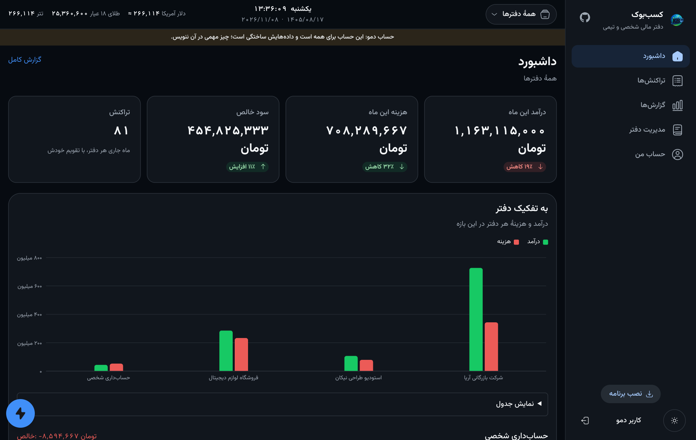
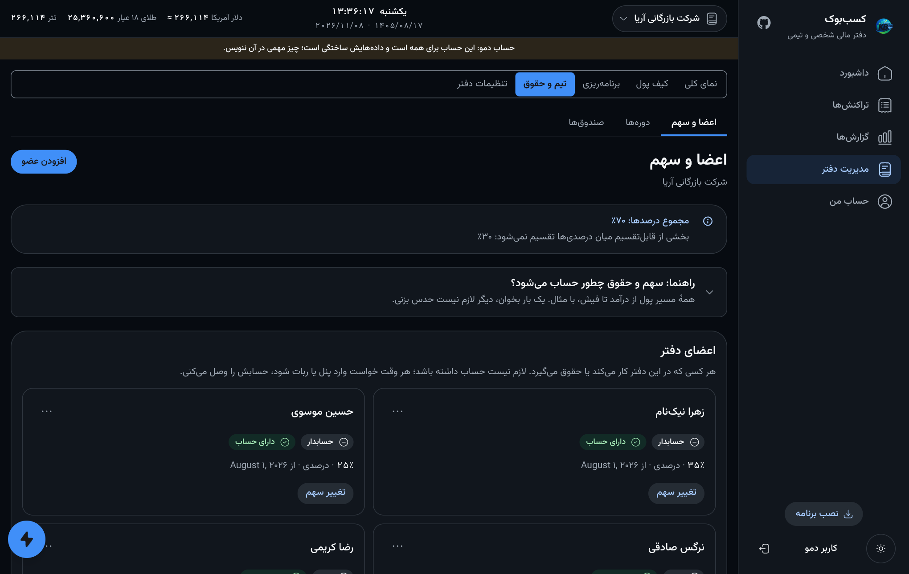
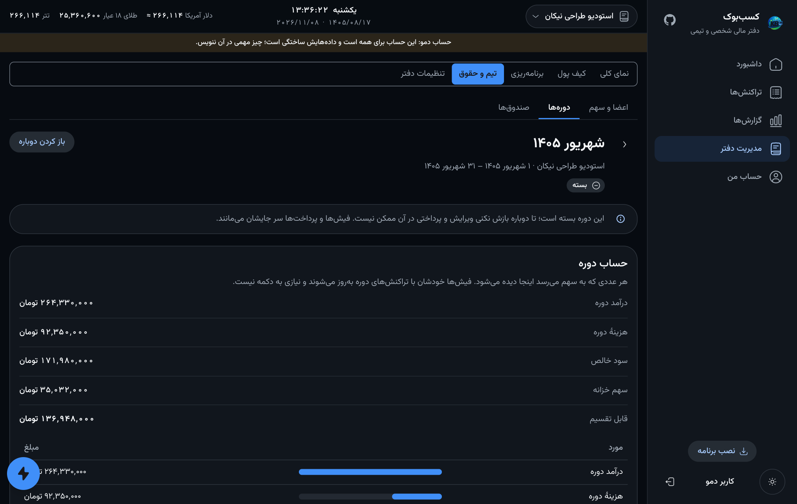

# The web panel

The panel is the bot's other face: the same account, the same books, the same
rules, drawn for a browser. It is for what a chat is bad at — a long
transaction list, a chart, a team's pay laid out on one page.

**Live:** <https://kasbbook.nyxon.tech> · press **«ورود به حساب دمو»** to look
around with ready-made data. The demo is one shared account for everybody, so
put nothing that matters in it. The panel is in Persian, right to left.

## Signing in

| Way | What it is |
|---|---|
| **Through the bot** | The panel shows a link into the bot on Telegram; one tap on «تأیید ورود» there signs this browser in. No password is typed anywhere. |
| **Username and password** | Chosen in *My account*; the username is lower-case and unique. |
| **Demo** | One shared account with four books and a year of transactions. Never claimable, renewed after 14 days. |
| **Guest** | A throwaway account; signing out removes it and everything in it. |

A refresh token slides, so a device in regular use never asks again. *My account →
Devices* lists where the account is signed in — **once per device**, with the
time of its last activity. Signing a device out ends every login it has made.

## What is in it

- **Dashboard** — this month's income, expense and net against last month, and a chart per book.
- **Transactions** — search, filters (period, kind, categories, currency, sort) that close when a single choice is made or when you confirm, attachments, and **every date written in Jalali and Gregorian side by side**.
- **Reports** — by month, year or category, with CSV export.
- **Wallet** — a balance per currency. A conversion shows what can be moved, fills the amount from a quarter, half, three quarters or all of it, and fills the received amount and its worth in the book's currency from today's price (still editable by hand).
- **Planning** — budgets, debts and loans.
- **Team** — see below.
- **Activity** (*My account → Events*) — who did what and when, from the panel, the bot or the API, with filters and a CSV report.

## The team pages

**Members and shares** is one page. A member can be added **by name only**,
with no account — paid and counted like anyone — and linked later to a real one
by email, phone, Telegram id or `@username`, which moves their shares, payslips
and records onto the account. A share is a percentage, a fixed amount, days,
hours, points or a fixed weight (*project*); a different cut for **one period
only** goes back to the previous one by itself. A guide on the page walks the
money from income to payslip with examples.

**Periods** list newest first. A period's page shows the arithmetic from income
to distributable, the recorded work, adjustments (a kind, a mode, and a helper
that multiplies days by a daily amount) and the payslips with their payments.
Payslips follow the period by themselves; there is no calculate button. A
closed period can be **opened again** by whoever may close it, and nothing it
holds is lost.

**Funds** are the treasury: rules that take a cut before profit is shared, and
the choice of whether costs come off before the split or out of the treasury.

## Installing it as an app

The panel is a PWA: on a phone, *Add to Home Screen* (iPhone) or the install
button (elsewhere) puts it on the home screen and it opens without browser
chrome.

## Under the hood

- **Stack:** Vite, React 19, TanStack Router and Query, Tailwind, and *Nasim*, the panel's own UI kit, vendored in `web/vendor/nasim`.
- **One source of truth:** the client in `web/src/api/generated` is generated from the API's OpenAPI document (`PYTHONPATH=src python -m kasbbook.api.openapi_export web/openapi.json`, then `bun run api:generate`), so the panel cannot call something the API does not have.
- **Served by the API:** `web/dist` is committed and mounted by the FastAPI app, so one process and one origin serve both — no CORS, no second deploy. Rebuild with `bun run build` before releasing.
- **Strings in one place:** every visible word is in `web/src/strings` and is Persian; nothing is hard-coded in a component.
- **Checks:** `bun run typecheck`, `bun run lint` and `bun run test` run in CI next to the Python suite.
